# AI Enablement: Moving Multi-Domain Teams to an AI-Enabled SDLC

**AI Enablement · AIDLC Transformation · Enterprise Rollout**

> A practical execution pipeline that moved 60+ developers, QA engineers, designers and BA/PM/documentation staff at Gate6 Technologies from traditional delivery to an AI-enabled SDLC in about 6–12 months, cutting a typical application build from 1–2 months to about one working week. The same pipeline was reused for organisation-wide enablement at Brand Concepts.

**Engineering areas:** [Generative AI Engineering](../../engineering-areas/generative-ai.md) · [AI Automation & Integrations](../../engineering-areas/ai-automation.md) · [RAG & Retrieval](../../engineering-areas/rag-retrieval.md)

## At a glance

- 60+ people enabled across 4 tracks
- 1–2 months to about one working week per application
- 30+ PoCs delivered in 2-week cycles
- Hundreds of agents built by the teams

## Overview

An AI enablement programme run as a 10-step execution pipeline, not a framework on paper. I worked inside each team to find the real bottlenecks, split 60+ people into four tracks (developers, QA, UI/UX design and BA/PM/documentation), ran separate R&D for each track, and matched each kind of work to the right model approach.

A small enablement team of developers and testers built every tool (RAG apps, agents, sub-agent skills, Claude projects and connectors), used it on its own work first, piloted it with one track, and then distributed it company-wide through four channels. By the end, the teams were building their own agents.

## The problem

When the enablement work started in 2024, delivery at Gate6 ran the traditional way: requirements, design, development, testing and documentation moved from person to person, mostly by hand, and a typical application took one to two months.

The people to enable did very different work: full-stack developers, QA engineers writing test cases, UI/UX designers, and BA, PM and documentation staff writing stories, business documents and release notes. A single "give everyone an AI tool" rollout would have been too much for some, too little for others, and impossible to measure.

## The solution

Ten steps, each with an owner, an input, an output and an exit check: discover, baseline, segment, segment R&D, build, dogfood, segment pilot, enterprise distribution, train and support, and measure. Once a track was enabled, new use cases from that track went straight back into segment R&D.

Four tracks, four R&D streams. Developers got Claude Code workflows, spec-driven development with BMAD, reusable agent patterns, prompt libraries and sub-agent skills. QA got test case generation and testing support. UI/UX got AI-assisted design and prototyping workflows. BA/PM/documentation got a Jira agent that pulls all stories and boards for a release, document generation and RAG apps over project knowledge.

Model tiers matched to the work. Text work such as test cases and business documents went to a small in-house model fine-tuned on our own data. Light interaction such as checking mails and code went to standard models. Full-stack development on client code went to Claude enterprise plans, chosen for security, with no custom model built.

## How it works

Every tool followed the same path. A use case from segment R&D was built as a PoC or MVP in a 2-week cycle by the enablement team, tested inside the team, and used on the team's own daily work. It left the team only when another engineer could safely take it over and maintain it, and when it could plug into the regular delivery pipeline. It was then piloted with one track before being distributed company-wide.

Before any use case entered a build cycle, it passed a simple test: predictable, rule-based work goes to traditional automation (APIs, schedulers, scripts); unstructured documents, natural-language questions, summaries and retrieval go to an LLM or RAG solution; and if a simple integration solves it reliably, that wins.

## Architecture

Distribution ran through four channels, chosen by what each tool was: Claude org connectors, plugins and skills for agents and tools people use inside Claude; shared Claude projects for team instructions, standards and knowledge; a shared Git repository for agents, skills, prompt libraries and reusable agent patterns, so any engineer could maintain them; and internal hosted apps for RAG apps and bots used by people who don't work in Claude or Git every day.

AI sat at every stage of the SDLC: the Jira agent and story writing at requirements, AI-assisted prototyping at design, Claude Code with BMAD specs and skills at development, test case generation at testing, generated business documents and release notes at documentation, and the Jira agent again to pull release scope.

## Challenges

Data quality for RAG. Most bad RAG answers come from bad data. Every RAG tool went through the same cleaning pipeline: collect the data, remove repeated content such as headers, footers and repeated CTA sections from scraped pages, separate inconsistent and poor-quality data, check consistency and freshness, and confirm chunking, embedding and ingestion work well before anything is stored in the vector store.

Inconsistent output in daily use. The most common complaint once tools were live was "it gave me something different this time". I debugged it in a fixed order: very long sessions first (they drift into their own patterns, especially for document design), then recent skill or agent updates, then memory carrying old context, and for RAG tools the chunks, vectors and ingestion.

## Results

At Gate6, 60+ developers, QA engineers, designers and BA/PM/documentation staff moved to AI-enabled ways of working in about 6–12 months from the first team to company-wide use. A typical application that took one to two months was built in about one working week. I personally designed and delivered 30+ PoCs, and the teams went on to build hundreds of agents and multi-agent systems for requirements, code generation, testing and pipeline work.

Success was measured against baselines agreed with each team before building: manual effort reduced, accuracy and reliability, time saved per task, cost, adoption and satisfaction, and security and compliance.

## What I learned

Work inside the team before designing anything. The tracks came from where the time actually went.

Segment by the work, not by seniority. Matching the model tier to the type of work kept sensitive client code on a secure platform and didn't send every request to a large model.

Put testers in the enablement team from day one, and dogfood everything. No tool reached another team until the enablement team had tested it and used it on its own work.

Meet people where they already work. Attaching tools to Claude as connectors, skills and projects meant nobody had to learn a new tool for every use case.

Saying no is part of the job. When an API or a scheduler solves the problem reliably, that is the better answer. The goal is business outcomes, not more AI.

The goal is builders, not users. The real result was teams building hundreds of their own agents.

## Future scope

Second run: Brand Concepts. I reused the same pipeline for organisation-wide AI enablement at Brand Concepts, a consumer brand, for nearly all staff across MIS, sales, pre-sales, post-sales, marketing, accounts and HR. The steps stayed the same; the balance changed. Business teams got department-wise hands-on AI training first, with a set of bots built where training alone wasn't enough.

Running it again. The pipeline is packaged as a reusable playbook (discovery interview, baseline sheet, segment R&D canvas, a "does this need AI?" checklist, a PoC release checklist and a rollout plan) so it can be run in another company.

## Diagrams

### The 10-step enablement pipeline

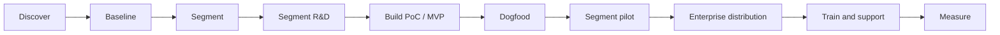

*Every step has an owner, an input, an output and an exit check. Once a track is enabled, new use cases loop back into segment R&D.*

### Where the teams started

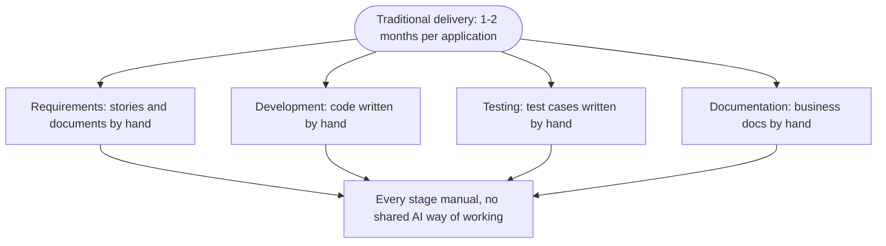

*Before enablement, every stage was manual and there was no shared AI way of working. A typical application took one to two months.*

### Four tracks, four R&D streams

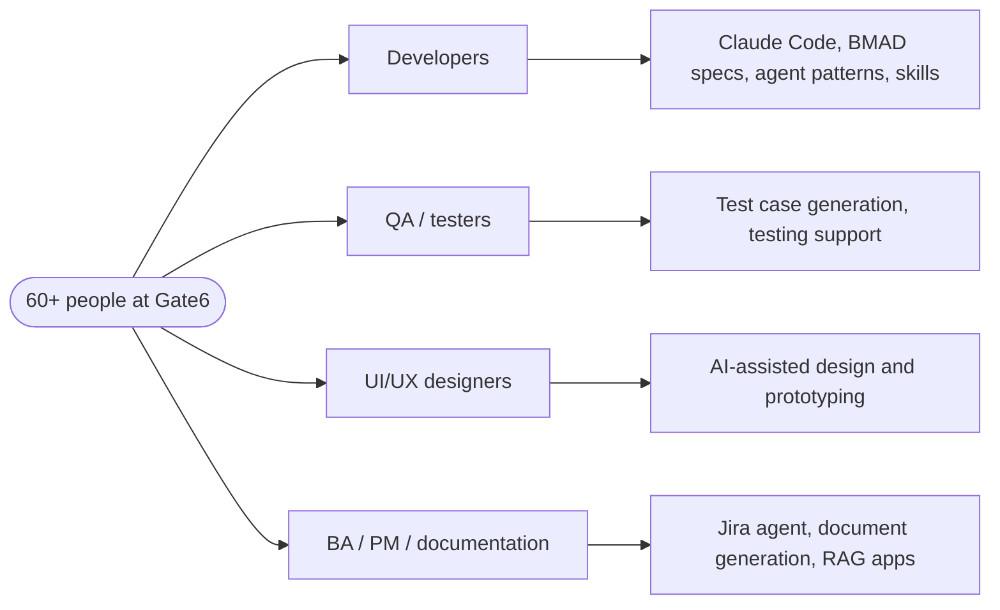

*Each track got its own use cases, tools and model approach.*

### Matching the model to the work

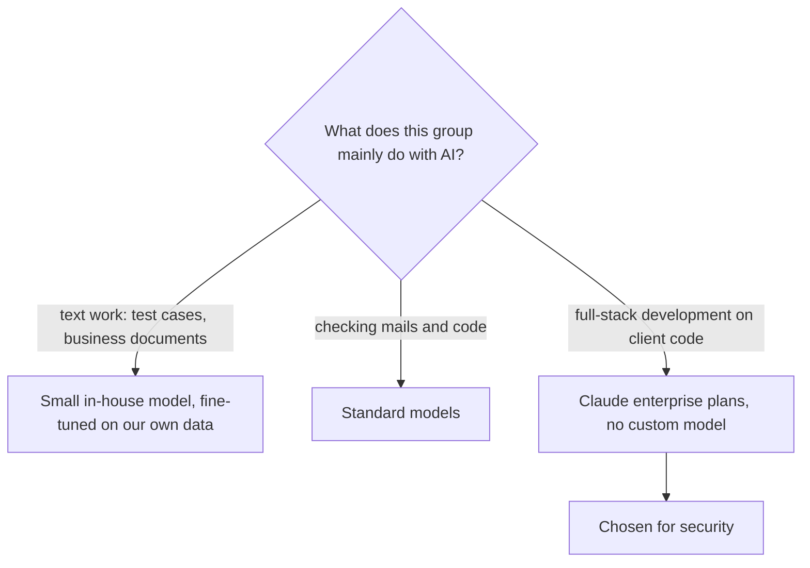

*Text work used a small in-house model, light interaction used standard models, and full-stack development on client code used Claude enterprise plans for security.*

### From idea to a tool others can maintain

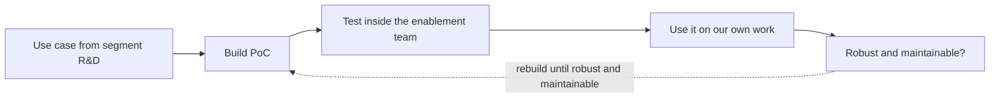

*A tool left the enablement team only when another engineer could safely take it over and it could plug into the regular pipeline.*

### Four distribution channels

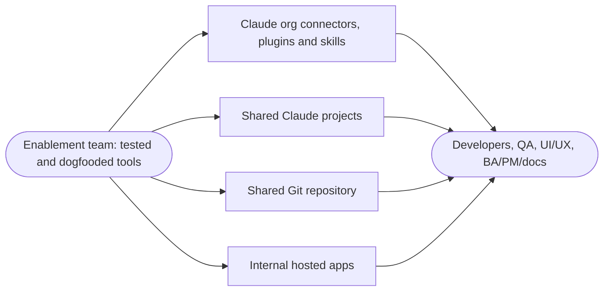

*Each tool went out through the channel that fit what it was: inside Claude, as a shared project, in Git, or as a hosted app.*

### Where AI sits in the SDLC

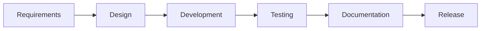

*Every stage of delivery got an AI-assisted way of working.*

### Cleaning data before RAG

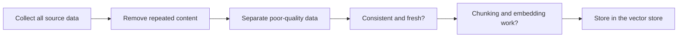

*Every RAG tool went through the same cleaning steps before anything reached the vector store.*

### Debugging inconsistent output

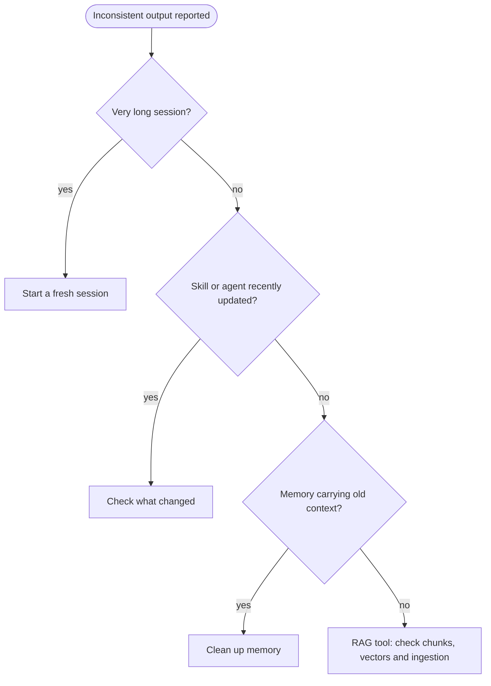

*Checked in a fixed order: long sessions, recent skill or agent updates, memory, and for RAG tools the chunks and vectors.*

### Where the numbers come from

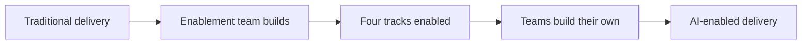

*From 1–2 months per application to about one working week, with 60+ people enabled, 30+ PoCs delivered and hundreds of agents built by the teams.*

### Second run: Brand Concepts

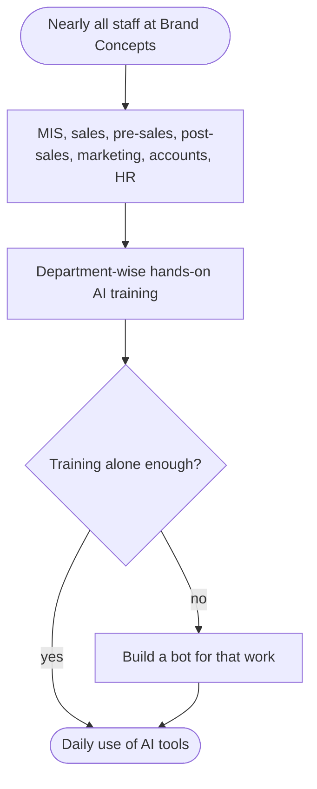

*Same pipeline, business audience: department-wise training first, and a bot built where training alone wasn't enough.*

## Tech stack

`Claude (enterprise plans)` · `Claude Code` · `Claude connectors, plugins and skills` · `Claude projects` · `BMAD (spec-driven AI development)` · `RAG` · `Vector store` · `Jira` · `Git` · `Python`

Read the full case study on [Prompt at Work](https://promptatwork.com/ai-lab/work/ai-enablement-aidlc-transformation).

---

Generated from Sanity by `scripts/sync_from_sanity.py`. Edit the content in Sanity Studio, not in this file.
