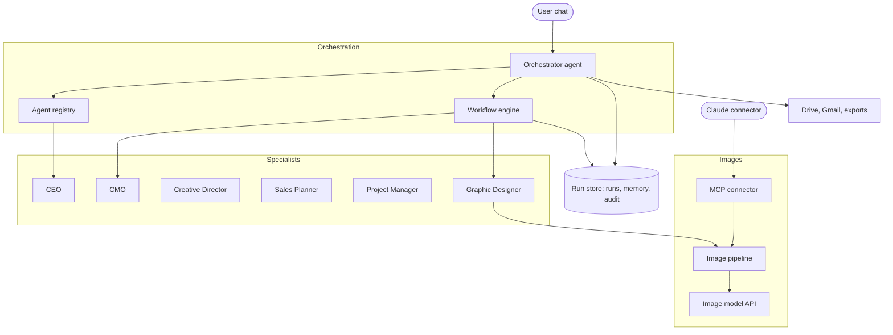

# AI Executive Command Center

**Custom Multi-Agent Orchestration · Framework-Free Runtime**

> A multi-agent orchestration system that works as a small brand's virtual executive team: one conversational orchestrator routes every request to six specialist agents, who produce campaign strategy, launch and event plans, roadmaps and print-ready apparel artwork. A full executive-team run takes about 60–90 seconds and $0.10–0.30.

**Engineering areas:** [Full-Stack AI Engineering](../../engineering-areas/full-stack-ai.md) · [Agentic AI](../../engineering-areas/agentic-ai.md) · [Systems, Reliability & Security Engineering](../../engineering-areas/systems-reliability-security.md)

## At a glance

- ~60–90 seconds per full 7-round strategy run
- ~$0.10–0.30 per full run (10–12 LLM calls)
- 1 orchestrator + 6 specialist agents
- 138 test files

## Overview

A multi-agent orchestration system that acts as the client's virtual executive team. The user talks to one conversational orchestrator agent, which works like a chief of staff: it works out what is being asked and hands the request to the right specialist. There are six specialists: a CEO, a CMO, a Creative Director, a Sales Planner, a Project Manager and a Graphic Designer.

Together they produce campaign strategy, launch and event plans, roadmaps, and print-ready t-shirt and marketing artwork. The system also exposes its OpenAI image generation to Claude as a custom MCP connector, so the team can generate images without leaving Claude.

## The problem

The client is a small founder-led apparel brand preparing a product launch of tees, hoodies, hats and stickers. Before this system, the founders did all the coordination by hand.

Campaign and launch strategy was brainstormed manually, with no single source of truth. Marketing, creative, sales and timeline ideas lived in separate docs and conversations, so plans contradicted each other (a premium price next to a mass-market channel, for example) and nobody reconciled them. Every t-shirt design and every channel-sized marketing visual meant briefing a designer, waiting and re-briefing, and the brand drifted between designs. Event and pop-up decisions were made ad hoc, with no structured look at cost, risk or timeline. Print placement and size were specified by hand for each garment, and deliverables were copy-pasted into docs and emails, so context and history were lost.

## Results

Measured system figures, from the project itself: a full executive-team run makes 10–12 LLM calls and takes about 60–90 seconds and $0.10–0.30. The codebase has 138 test files covering unit and integration tests, regression checks for prompt directives, acceptance gates, adversarial security probes, a multi-intent classifier corpus replay, and accessibility. The database schema is versioned with reversible migrations.

I don't have measured business outcomes, so the before-and-after is qualitative. Cross-functional strategy that used to be founder meetings and scattered docs is now a single run with conflicts resolved automatically. Campaign visuals come back as 1–4 on-brand variants per request in every channel format. A design goes from request to printable graphic, mockups and a print kit in one flow. Event decisions get a structured go/no-go with cost, risk and timeline. And every run is saved with a permalink, so it can be resumed, exported or emailed.

## What I learned

A single orchestrator beats self-routing agents. Having exactly one agent allowed to choose another made routing predictable, testable and easy to explain to the user.

Sequencing plus reconciliation beats parallel, blind agents. The extra rounds cost time, but they produce one plan instead of six that disagree.

Enforce brand rules in code, not only in prompts. Server-side brand chrome holds even when a model ignores an instruction.

Security on prompts should fail closed. A missing preamble stops the agent rather than letting it run unprotected.

Build the patterns by hand first. Working framework-free, I implemented the core agentic patterns directly: routing, orchestrator–workers, prompt chaining, parallelisation, a reflection loop, memory, guardrails and human-in-the-loop. That made every prompt and every routing decision easy to debug, and it shows clearly what a framework would and wouldn't add.

## Diagrams

### How the system fits together

*One Next.js process holds everything: the orchestrator, the agent registry and workflow engine, the specialists, the image pipeline and the MCP connector, with a run store for runs, memory and audit records. No agent framework sits in between.*

### Which lane handles the request?

*The orchestrator decides the route, not the user: unclear requests get a question, and clear ones go to the full team, one specialist, a multi-agent recipe, a previous run, or a utility action that needs confirmation before anything leaves the app.*

## Tech stack

`Next.js (App Router)` · `React` · `TypeScript` · `Node.js` · `Embedded SQL database` · `Zod` · `MCP TypeScript SDK` · `Native provider SDKs (no agent framework)` · `sharp` · `docx` · `pdfkit` · `Vitest` · `GitHub Actions` · `Server-Sent Events`

## Related work

**Experiments**

- [Multi-Agent Coordination: Sequential State-Passing vs a Shared Blackboard](../../experiments/README.md#multi-agent-state-passing-vs-blackboard)

**Automations**

- [Brief-to-Print Asset Generation Pipeline](../../automations/README.md#apparel-design-to-print-kit)
- [Secure MCP Gateway for Third-Party Image Models](../../automations/README.md#claude-openai-image-mcp-connector)

**Prompt patterns**

- Brief Expander: Casual Request to Structured Brief
- Confidence-Gated Intent Router with a Clarify-First Rule
- Specialist Agent Role Scaffold (Persona, Inputs, Handoff Awareness)
- Untrusted-Input Boundary Guardrail (Prompt-Injection Defence)

Read the full case study on [Prompt at Work](https://promptatwork.com/ai-lab/ai-executive-command-center).

---

Generated from Sanity by `scripts/sync_from_sanity.py`. Edit the content in Sanity Studio, not in this file.
