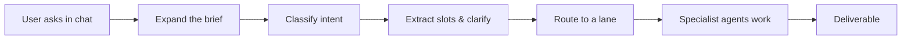
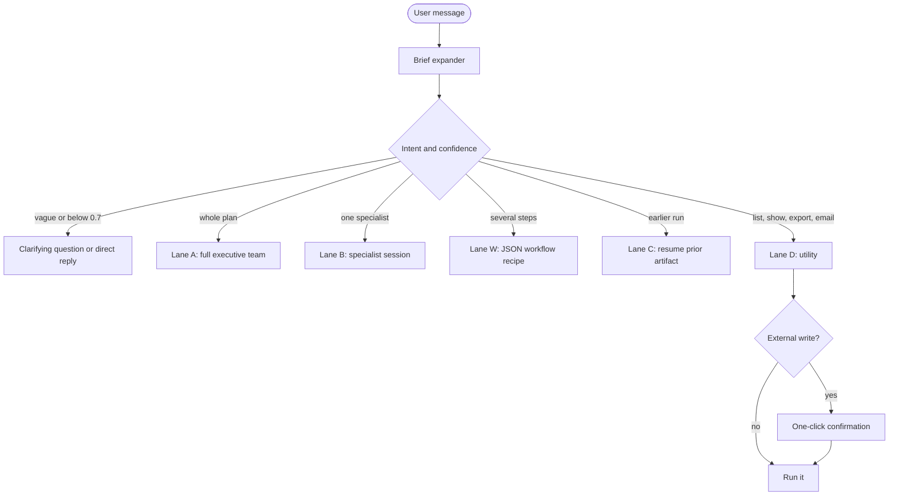
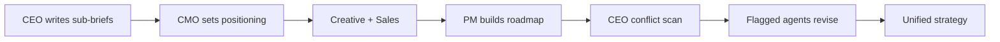
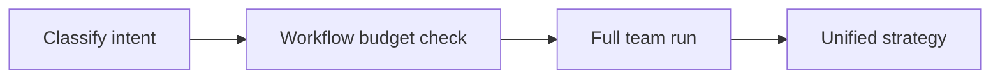
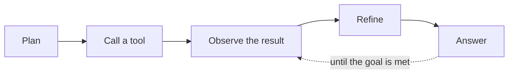
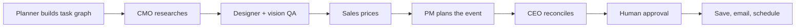
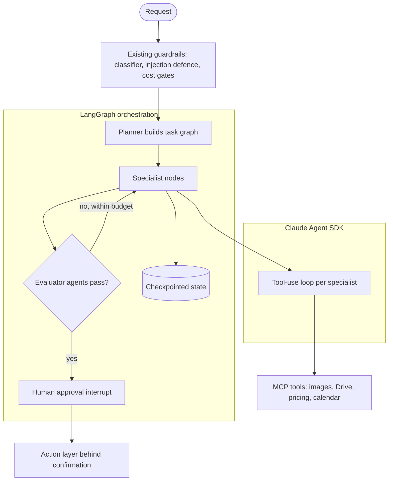
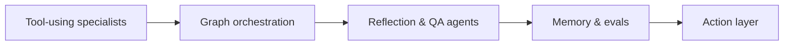

# AI Executive Command Center

**Custom Multi-Agent Orchestration · Framework-Free Runtime**

> A multi-agent orchestration system that works as a small brand's virtual executive team: one conversational orchestrator routes every request to six specialist agents, who produce campaign strategy, launch and event plans, roadmaps and print-ready apparel artwork. A full executive-team run takes about 60–90 seconds and $0.10–0.30.

**Engineering areas:** [Full-Stack AI Engineering](../../engineering-areas/full-stack-ai.md) · [Agentic AI](../../engineering-areas/agentic-ai.md) · [Systems, Reliability & Security Engineering](../../engineering-areas/systems-reliability-security.md)

## At a glance

- ~60–90 seconds per full 7-round strategy run
- ~$0.10–0.30 per full run (10–12 LLM calls)
- 1 orchestrator + 6 specialist agents
- 138 test files

## Overview

A multi-agent orchestration system that acts as the client's virtual executive team. The user talks to one conversational orchestrator agent, which works like a chief of staff: it works out what is being asked and hands the request to the right specialist. There are six specialists: a CEO, a CMO, a Creative Director, a Sales Planner, a Project Manager and a Graphic Designer.

Together they produce campaign strategy, launch and event plans, roadmaps, and print-ready t-shirt and marketing artwork. The system also exposes its OpenAI image generation to Claude as a custom MCP connector, so the team can generate images without leaving Claude.

## The problem

The client is a small founder-led apparel brand preparing a product launch of tees, hoodies, hats and stickers. Before this system, the founders did all the coordination by hand.

Campaign and launch strategy was brainstormed manually, with no single source of truth. Marketing, creative, sales and timeline ideas lived in separate docs and conversations, so plans contradicted each other (a premium price next to a mass-market channel, for example) and nobody reconciled them. Every t-shirt design and every channel-sized marketing visual meant briefing a designer, waiting and re-briefing, and the brand drifted between designs. Event and pop-up decisions were made ad hoc, with no structured look at cost, risk or timeline. Print placement and size were specified by hand for each garment, and deliverables were copy-pasted into docs and emails, so context and history were lost.

## The solution

One orchestrator, six specialists. The orchestrator is the only agent allowed to choose another agent, and it never produces deliverables itself. Each specialist is defined in a data-driven agent registry with its own prompt file, model, slot schema (the information it needs before it can work), the intents it handles, its default collaborators and a cost tier. An admin can bind any agent to a different provider and model from Settings.

The user never picks an agent. Every message goes through the orchestrator's pipeline: a brief expander turns casual chat into a structured brief, an intent classifier picks one of 15 intents, slot extraction pulls out goal, audience, channel, timeline, budget and the rest, and a clarifier asks numbered questions when something is missing. If the classifier's confidence is below 0.7, the orchestrator must ask a clarifying question instead of guessing. the orchestrator also never re-asks for something the user has already given.

The orchestrator then routes the request to a lane. Lane A runs the full executive team. Lane B opens a multi-turn session with one specialist. Lane W runs a multi-agent workflow defined as a JSON recipe. Lane C resumes a previous run. Lane D handles utility actions (list, show, export, email), and anything that writes outside the app needs a one-click confirmation first. Vague or conversational messages get a direct reply or a clarifying question and are not routed at all. The user sees each routing decision as a chip.

The most important design decision was to sequence the agents and reconcile them, rather than run them side by side. Earlier prototypes ran the agents in parallel, each blind to the others, and the CEO never synthesised their results. In the redesigned pipeline the CMO lays the foundation first, the others build on it, and the CEO finds the real conflicts between their plans and resolves them into one strategy. Each downstream agent is told who worked before it and that the CEO will reconcile, which makes agents commit to specifics instead of hedging.

Brand consistency is enforced in code, not only in prompts. A brand canon document and a workspace brand kit are filled into every prompt automatically, and logo and brand elements are appended server-side to every image prompt, so the brand holds even when the model forgets.

## How it works

A full executive-team run (Lane A) works in seven rounds:

Round 1: the CEO assesses the brief and writes 4 targeted sub-briefs.
Round 2: the CMO defines market and positioning, which is the foundation for everyone else.
Round 3: the Creative Director and Sales Planner work in parallel against the CMO's foundation.
Round 4: the Project Manager builds a roadmap that accounts for everyone's plans.
Round 5: the CEO scans all the reports, finds real conflicts, and asks 1–3 questions as structured JSON.
Round 6: the flagged agents revise their positions.
Round 7: the CEO writes one unified strategy document.

Every round streams live, token by token, to a round-by-round timeline in the UI using Server-Sent Events. The output is the unified strategy plus appendices: every agent's report, the conflict scan and the resolutions. It exports to .docx and .pdf and gets a shareable permalink, and Lane C can later load it and continue from it.

Smaller jobs don't need the whole team. A request for "a marketing plan and a hero image for it" runs a Lane W recipe: the CMO drafts the strategy, the CMO extracts a visual brief from it, and the Graphic Designer generates the image. Because the earlier step fills the Designer's required slots, the Designer skips its clarifying questions.

## Architecture

The app is a single Next.js process with no separate agent backend, plus a lightweight embedded database for runs, memory and audit records.

Orchestration layer: an orchestrator agent on a small, fast model at low temperature. A separate brief-expander call turns casual chat into a structured brief using recent conversation memory and the brand kit, and fails soft by passing the raw input through on error. Conversation memory is a short rolling window plus pointers to the active run, encrypted at rest.

Specialists: the CEO, CMO, Creative Director, Sales Planner and Project Manager run on a stronger model; the Graphic Designer on the fast one. A provider factory supports several providers and binds them per agent, separately for text and image work, using each provider's native SDK.

Workflow engine: workflows are configuration, so new ones can be composed from registered agent actions without code. Steps pass a handoff envelope containing the original request, accumulated slots, prior step outputs, the sub-task and the remaining budget. Envelopes are checked so that no credentials can ever travel between agents. Each run has a cost ceiling, and the engine refuses to start the next step once it is exceeded. Progress is saved after every step, so a retry resumes from the failed step, and workflows are validated at startup so loops can't be authored by mistake.

Prompts are content, not code: each agent's prompt is a versioned file editable by product owners without a deploy. An invalid prompt falls back to a known-good built-in prompt.

Image pipeline and MCP: the Graphic Designer feeds an image pipeline with templates, brand chrome, garment mockups and a print kit, and the same image generation is exposed to Claude through an authenticated MCP connector built into the app. Both are written up as separate automations.

Integrations: Google sign-in, Google Drive (import files into agent context and save deliverables), Gmail (email a strategy PDF, always confirmed first), file uploads parsed to text, and exports to .docx and .pdf.

User-facing modules: the orchestrator chat, a one-on-one Workspace with a single agent, Runs history with permalinks, a prompt library with presets, Files, Settings, and an Ops dashboard for telemetry and budget.

## Challenges

Agents that contradict each other. Running specialists in parallel produced plans that disagreed, and nothing reconciled them, which was exactly the founders' original problem. Sequencing the agents and adding the CEO's conflict scan and revision rounds fixed this, at the cost of a longer run.

Context between agents. When the user moves from one specialist to the next, the previous report is compressed to its headings and key sentences, which keeps context intact across chains of several agents without the token count blowing up.

Prompt injection. Every agent treats user-supplied content as data, never as instructions, and the orchestrator's classifier is hardened so a user can't talk it into a different route. Both defences fail closed: if a guard is missing, the agent refuses to run.

Multi-tenant security. Every record is scoped to its owner. Cross-account access is blocked without revealing whether the record exists, is written to the audit log, and is covered by automated isolation tests across the API. Secrets are encrypted at rest and kept out of code.

Cost. Each workflow run has a budget ceiling, and the cost estimator refuses unknown models rather than letting a cost check be skipped.

## Results

Measured system figures, from the project itself: a full executive-team run makes 10–12 LLM calls and takes about 60–90 seconds and $0.10–0.30. The codebase has 138 test files covering unit and integration tests, regression checks for prompt directives, acceptance gates, adversarial security probes, a multi-intent classifier corpus replay, and accessibility. The database schema is versioned with reversible migrations.

I don't have measured business outcomes, so the before-and-after is qualitative. Cross-functional strategy that used to be founder meetings and scattered docs is now a single run with conflicts resolved automatically. Campaign visuals come back as 1–4 on-brand variants per request in every channel format. A design goes from request to printable graphic, mockups and a print kit in one flow. Event decisions get a structured go/no-go with cost, risk and timeline. And every run is saved with a permalink, so it can be resumed, exported or emailed.

Operationally, structured telemetry separates alerting events from dashboard-only events, shown on the Ops dashboard, and delivery runs through a GitHub Actions CI/CD pipeline.

## What I learned

A single orchestrator beats self-routing agents. Having exactly one agent allowed to choose another made routing predictable, testable and easy to explain to the user.

Sequencing plus reconciliation beats parallel, blind agents. The extra rounds cost time, but they produce one plan instead of six that disagree.

Enforce brand rules in code, not only in prompts. Server-side brand chrome holds even when a model ignores an instruction.

Security on prompts should fail closed. A missing preamble stops the agent rather than letting it run unprotected.

Build the patterns by hand first. Working framework-free, I implemented the core agentic patterns directly: routing, orchestrator–workers, prompt chaining, parallelisation, a reflection loop, memory, guardrails and human-in-the-loop. That made every prompt and every routing decision easy to debug, and it shows clearly what a framework would and wouldn't add.

## Future scope

Where it stands today. In strict terms, most of the system is an agentic workflow, not a set of autonomous agents, and that was deliberate. Code decides the control flow, and each specialist is a single-pass LLM call with its own persona, prompt, model and slot schema. The specialists don't choose or call tools themselves; image generation, Drive and Gmail are triggered by code or parsed directives. The pipeline order is fixed, and the orchestrator picks a route but doesn't re-plan mid-run. Agents can't consult each other directly, nothing checks its own output yet, and workflow state is saved per step by our own runtime rather than by a durable graph engine. The architecture was designed so that autonomy can be added on top rather than rewritten around.

What changes with tool-using agents. Each specialist becomes an agent loop: plan, call tools, observe the result, refine, and only then answer, so outputs are grounded and checked rather than single-shot text. Agents choose their own tools, such as image generation, trend search, past-run lookup and pricing, with external actions still behind the confirmation step. The orchestrator becomes a planner that builds a task graph with only the agents a request needs, and re-plans when a step fails. Agents can ask each other questions directly (Sales asking the CMO about the target segment, for example), which should mean fewer contradictions before the CEO's conflict scan; the blackboard experiment tests exactly this.

Making it more robust. Evaluator agents check the work: a brand-compliance checker, a fact and number checker, and a vision model that compares each generated image with the brief and retries failures. Checkpointed state lets a run pause, resume, branch, replay a step or wait for human approval at any point. Parallel fan-out cuts latency. Long-term memory of past runs lets agents learn the brand. Full tracing plus continuous evaluation of routing accuracy, brand adherence, image-brief match and cost per deliverable make quality measurable, and dynamic model routing lowers cost at the same quality.

Framework or not. A framework will be adopted only where it clearly earns its place. The Claude Agent SDK is the most natural candidate for each specialist's internal tool loop, because the stack is already Claude-first; a graph runtime such as LangGraph is the candidate for durable, checkpointed orchestration. CrewAI maps neatly onto the executive team and is quick to prototype, but gives less control. Each candidate will be compared against the current runtime before anything is replaced.

The roadmap, in five phases: tool-using specialists first (Designer and CMO); then checkpointed orchestration with approval pauses; then brand and vision QA agents with retry loops under budget caps; then run memory, tracing and a continuous eval suite; and finally an action layer of calendar, social scheduling, commerce and print connectors through MCP, all behind the existing confirmation step.

What stays. The production safeguards already built carry over unchanged: fail-closed prompt-injection defence, per-run cost ceilings, strict per-account data isolation, credential-free handoffs between agents, the authenticated MCP connector, confirm-before-act on external actions, and brand enforcement in code.

## Diagrams

### From a chat message to a deliverable

*Every request goes through the orchestrator: it is expanded into a brief, classified, checked for missing details, routed to a lane, and handled by the right specialists, who return a strategy document or artwork.*

### The orchestrator, explained

| An orchestrator agent routing to specialists | A hospital triage nurse |
|---|---|
| Classify the request's intent | Assess the patient's symptoms |
| Confidence below 0.7 → ask a clarifying question | Unsure → ask more questions before deciding |
| Route to a lane or specialist | Send the patient to the right department |
| The orchestrator never produces deliverables itself | The triage nurse doesn't operate |
| Slot continuity: never re-ask a given detail | The patient's chart travels with them |

*The orchestrator works like triage: it assesses the request, asks more questions when unsure, and sends it to the right department, but never does the specialist work itself. The analogy stops at the CEO rounds, which have no triage equivalent.*

### Which lane handles the request?

*The orchestrator decides the route, not the user: unclear requests get a question, and clear ones go to the full team, one specialist, a multi-agent recipe, a previous run, or a utility action that needs confirmation before anything leaves the app.*

### How the system fits together

*One Next.js process holds everything: the orchestrator, the agent registry and workflow engine, the specialists, the image pipeline and the MCP connector, with a run store for runs, memory and audit records. No agent framework sits in between.*

### The 7-round executive-team run

*The CEO splits the brief, the CMO sets the foundation, Creative and Sales build on it in parallel, the PM builds the roadmap, then the CEO finds conflicts, the flagged agents revise, and the CEO writes one unified strategy.*

### Where the numbers come from

*System figures from the project, placed on the step they belong to: the classifier's 0.7 confidence threshold, the default $0.20 ceiling per workflow run, and the 10–12 calls, 60–90 seconds and $0.10–0.30 of a full executive-team run.*

### From one call to an agent loop

*Today each specialist makes one LLM call and returns text. In the agentic version it plans, calls a tool, observes the result and refines, going round again until the goal is met, and only then answers.*

### A t-shirt drop, run the agentic way

*The planner builds a task graph, the CMO researches with tools, the Designer's images pass a vision QA check before the print kit, Sales prices with a tool, the PM schedules, the CEO reconciles, and a person approves before anything is sent.*

### Where each framework fits

*The planned split: LangGraph runs the orchestration graph with checkpoints and approval steps, each specialist runs its own tool loop on the Claude Agent SDK, tools come in through MCP, and the existing guardrails stay in front of everything.*

### From workflow to agents, in five phases

*The planned order: tool-using specialists first, then graph orchestration, then reflection and QA agents, then memory and evals, and finally an action layer of external connectors behind the existing confirmation step.*

## Tech stack

`Next.js (App Router)` · `React` · `TypeScript` · `Node.js` · `Embedded SQL database` · `Zod` · `MCP TypeScript SDK` · `Native provider SDKs (no agent framework)` · `sharp` · `docx` · `pdfkit` · `Vitest` · `GitHub Actions` · `Server-Sent Events`

## Related work

**Experiments**

- [Multi-Agent Coordination: Sequential State-Passing vs a Shared Blackboard](../../experiments/README.md#multi-agent-state-passing-vs-blackboard)

**Automations**

- [Brief-to-Print Asset Generation Pipeline](../../automations/README.md#apparel-design-to-print-kit)
- [Secure MCP Gateway for Third-Party Image Models](../../automations/README.md#claude-openai-image-mcp-connector)

**Prompt patterns**

- Brief Expander: Casual Request to Structured Brief
- Confidence-Gated Intent Router with a Clarify-First Rule
- Specialist Agent Role Scaffold (Persona, Inputs, Handoff Awareness)
- Untrusted-Input Boundary Guardrail (Prompt-Injection Defence)

Read the full case study on [Prompt at Work](https://promptatwork.com/ai-lab/ai-executive-command-center).

---

Generated from Sanity by `scripts/sync_from_sanity.py`. Edit the content in Sanity Studio, not in this file.
