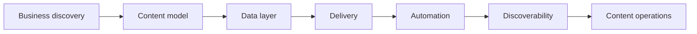
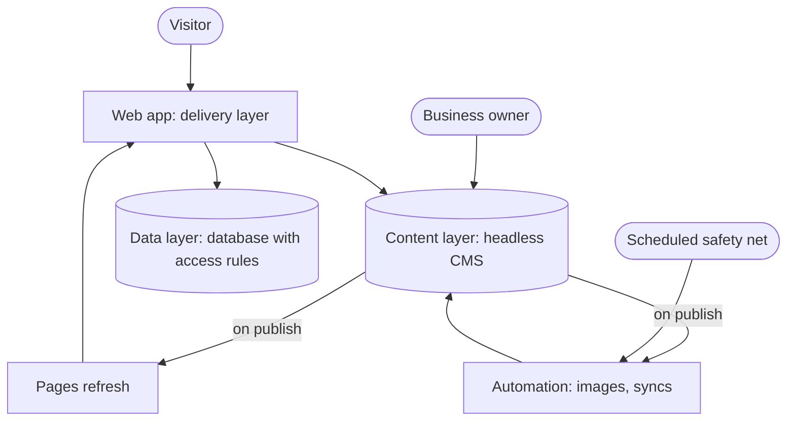
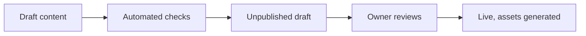

# AI Enterprise Blueprint: Building Content-Driven Business Platforms

**Solution Blueprint · Enterprise Web Platforms**

> The repeatable case-study process we follow to turn a business that needs to showcase and sell its work into a living platform: content the owner can publish, real data capture, and automation that keeps it fresh, instead of a static website.

**Engineering areas:** [Full-Stack AI Engineering](../../engineering-areas/full-stack-ai.md) · [AI Automation & Integrations](../../engineering-areas/ai-automation.md) · [Systems, Reliability & Security Engineering](../../engineering-areas/systems-reliability-security.md)

## At a glance

- 3 layers: content, data, delivery
- 7 planning stages
- Publish without a code deploy
- Security reviewed at every stage

## Overview

When a business asks for a website, what it usually needs is a platform: a place to showcase work, sell courses or services, capture leads and keep publishing without calling a developer each time.

This blueprint is the case-study process we follow for every such project. It starts from the business, not the pages, and works through the same seven stages each time, so a coaching business, a clinic, a training institute or a consultancy all get a platform they can run themselves.

## The problem

Static websites go stale. The copy is hard-coded, so every new offering, project or announcement needs a developer and a deploy. Owners stop updating, leads get lost in inboxes, and search engines and AI assistants describe the business from old information.

The underlying gap is that a static site treats content as code. A business needs content it owns and can change daily, plus somewhere real for enquiries and sign-ups to land.

## The solution

We plan every platform in seven stages, documented as a case study before code is written.

1. Business discovery: what the business sells, who updates what, and what a visitor must be able to do.
2. Content model: every repeatable thing (offering, project, testimonial, post, event) becomes a structured content type the owner edits in a CMS. Pages are assembled from it, never hard-coded.
3. Data layer: anything a visitor submits goes to a real database with access rules enforced in the database itself, not only in the form.
4. Delivery: server-rendered pages that refresh automatically when the owner publishes, so updates go live in moments with no deploy.
5. Automation: routine upkeep, such as cover images, syncing an external channel or refreshing listings, runs on its own, with a scheduled safety net behind every automated step.
6. Discoverability: structured data, social previews and an AI-readable summary so search engines and assistants describe the business accurately.
7. Content operations: a review-first publishing workflow, so AI-assisted drafts never go live without a human check.

## How it works

How a new piece of content flows on a finished platform:

1. The owner (or an AI drafting assistant) prepares the content.
2. Automated checks confirm required fields are filled and that every claim and number traces back to the owner's own source notes.
3. It lands in the CMS as an unpublished draft.
4. The owner reviews and presses Publish.
5. The site refreshes on its own, and supporting assets such as a cover image are generated automatically.

The same review-first rule applies to every client: AI can draft, but only a person publishes.

## Architecture

Every platform built with this blueprint has three layers, each with one job.

Content layer: a headless CMS holds everything the business publishes, as structured types with validation, so the owner can't publish something half-filled. Visuals such as process diagrams are stored as data and drawn by the site, so they stay consistent with the brand.

Data layer: a managed Postgres database holds what visitors submit, such as enquiries, registrations, comments and testimonials. Access rules live in the database, user-submitted content waits for approval before it appears, and anything sensitive (like booking a limited seat) goes through one validated server-side path.

Delivery layer: a modern React framework renders pages on the server and refreshes them when content changes. External services are connected through adapters, so adding a new source later doesn't change the rest of the system.

Around all three: authenticated automation, structured data for search and AI assistants, and secrets kept only in the hosting environment, never in code or content.

## Challenges

Keeping cross-linked content fresh. On a platform, one item appears in many places (home page, listings, related links). We design refresh around the whole experience rather than single pages, so nothing shows stale content after a publish.

Slow automated work. Generating images or syncing external channels can take longer than a publish event allows. We run that work in the background and back it with a scheduled sweep, so nothing is silently missed.

Limited-capacity sign-ups. When a course batch or appointment slot has limited seats, two people can race for the last one. We make booking a single atomic, validated operation so capacity can't be oversold.

Changing the structure later. As a business grows, sections merge and URLs change. We plan permanent redirects from day one so shared and indexed links keep working.

Being public and secure. Platforms like these are often fully public. We assume every visitor can see the front end and design so that nothing important depends on being hidden.

## Results

What a business gets from this blueprint: a platform the owner publishes to directly, with no developer needed for routine updates; enquiries and registrations captured in one database instead of scattered inboxes; content that keeps itself current through automation; and accurate visibility in search and AI assistants.

We have applied it end to end on our own platform, which runs its portfolio, training catalogue, batches, publishing and video library this way.

## What I learned

Model the content before designing pages. Once the business's offerings are defined as data, pages, search and AI summaries follow from them.

Enforce rules where the data lives. Protection in the database holds even if a form is bypassed.

Every automation needs a safety net. A scheduled check behind each automated step catches what events miss.

AI drafts, people publish. Checks that tie every number to the owner's own notes stop a model from inventing results.

Write the case study first. Planning the platform as a case study before building makes scope, trade-offs and handover clear for the client.

## Future scope

Where the blueprint is heading: an on-site AI assistant that answers visitor questions from the business's own published content, a single admin dashboard that brings content and visitor submissions together, and newsletter automation that brings readers back to new posts.

## Diagrams

### The seven planning stages

*Every project moves through the same seven stages, from understanding the business to a review-first publishing workflow the owner can run on their own.*

### Static website vs content platform

| A content-driven business platform | A shop window the owner can rearrange |
|---|---|
| Content stored in a CMS, not in code | Stock kept in the back room, not painted on the window |
| The owner publishes directly | The owner rearranges the window herself |
| Pages refresh on publish | The window changes the moment it's rearranged |
| A database captures sign-ups and enquiries | The counter where customers sign up and leave notes |

*A static site is like a printed brochure: changing a line means reprinting. A content platform is like a shop window the owner rearranges every day without calling the builder. The analogy stops at automation, which has no shop equivalent.*

### The three layers

*Visitors use one web app. The owner publishes to the content layer, visitor submissions go to the data layer, and automation keeps content and assets current in the background.*

### Review-first publishing

*Content can be drafted by the owner or with AI help, but it passes automated checks and a human review before anything goes live.*

## Tech stack

`Next.js / React / TypeScript` · `Headless CMS (e.g. Sanity)` · `Managed Postgres (e.g. Supabase)` · `Serverless hosting with scheduled jobs (e.g. Vercel)` · `Schema validation` · `Diagram-as-code`

## Related work

**Experiments**

- [Schema Validation Reliability for AI-Drafted Content and Automation Recovery](../../experiments/README.md#ai-drafted-content-validation-and-recovery)

**Automations**

- [Publish-Triggered Content Refresh & Asset Generation Pipeline](../../automations/README.md#publish-triggered-refresh-asset-generation)

**Prompt patterns**

- AI-Assisted Systems Engineering: Architecture, Edge-Case and Artifact Review

Read the full case study on [Prompt at Work](https://promptatwork.com/ai-lab/work/content-driven-business-platform-blueprint).

---

Generated from Sanity by `scripts/sync_from_sanity.py`. Edit the content in Sanity Studio, not in this file.
