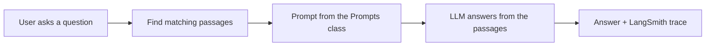
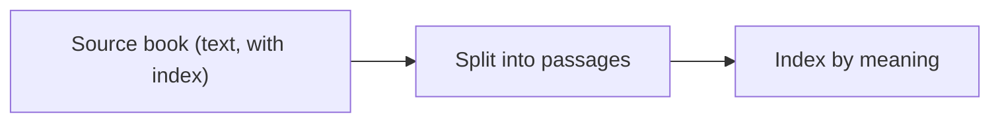

# Framework-Based Knowledge Retrieval Pipeline (LangChain Reference Build)

**Reference Build · RAG · LangChain**

> A retrieval-augmented Q&A pipeline built deliberately on LangChain, with a SOLID code structure, a dedicated prompt layer and LangSmith tracing. It is our framework-based reference build, used to compare development speed, control and observability against the first-principles SDLC artifact pipeline.

**Engineering areas:** [RAG & Retrieval](../../engineering-areas/rag-retrieval.md) · [Generative AI Engineering](../../engineering-areas/generative-ai.md)

## At a glance

- Built on LangChain + LangSmith
- Prompts in a dedicated layer
- Reference for the framework comparison

## Overview

Most of our retrieval systems are built without agent frameworks. To make that choice on evidence rather than preference, we also built the same kind of system the framework way.

This pipeline answers plain-language questions from a single, structured reference book with an index, used as a test corpus because its facts are easy to check. It is built on LangChain's standard components, traced in LangSmith, and organised with SOLID principles so it can be compared fairly with the custom pipeline.

## The problem

General chatbots answer from what they learned in training, so for a specific business's information they can be vague, out of date or simply wrong. A client needs answers grounded in its own material, and a way to see why the bot answered the way it did.

## The solution

Retrieval-augmented generation (RAG). Instead of trusting the model's memory, the bot first finds the passages of the book that relate to the question, then asks the model to answer using only those passages.

The code follows SOLID principles, with each responsibility in its own place. Prompts live in a dedicated Prompts class rather than being scattered through the code, so they can be read, changed and versioned on their own. LangSmith tracing records each run, so we can see which passages were retrieved and what the model was given for any answer.

## How it works

1. Ingest: load the book, split it into passages, index them.
2. Ask: the user types a question.
3. Retrieve: the closest passages are fetched.
4. Answer: the model writes an answer from those passages.
5. Trace: the whole run is recorded in LangSmith for review.

## Architecture

Two phases, as in every RAG system.

Preparing the knowledge: the book is loaded, split into passages and indexed so passages can be found by meaning, not just keywords.

Answering: the user's question is matched against the index, the most relevant passages are retrieved, and the model receives the question plus those passages through a prompt from the Prompts class, which tells it to answer from the provided text.

Observability: every step of each run is traced in LangSmith, which makes wrong or weak answers easy to diagnose: was the right passage retrieved, or did the model ignore it?

## Challenges

Keeping answers grounded. The core risk in any RAG bot is the model filling gaps from its own memory. Keeping the prompt focused on the retrieved text, and checking traces, is how we spot and correct that.

Keeping prompts maintainable. Prompts change more often than code. Putting them in one dedicated class keeps every change in one place and makes them easy to version later.

Seeing inside the pipeline. Without tracing, a wrong answer is a black box. LangSmith shows exactly which passages were retrieved for each question.

## Results

The pipeline answers questions from the test corpus through a traceable LangChain pipeline, and serves as the framework-based side of a documented comparison with the first-principles pipeline. It hasn't been measured with a formal evaluation yet, so there are no accuracy figures to report.

## What I learned

Ground first, generate second. Retrieval is what turns a general model into a business's own assistant.

Treat prompts as first-class code. A dedicated Prompts class makes them easy to review, change and version.

Trace from day one. Being able to see retrieval and generation for every answer is what makes a RAG bot improvable.

## Future scope

Planned next: LangSmith prompt versioning, an evaluation set to score answers against the corpus, and A/B testing of prompts. The same evaluation set, run against both this build and the first-principles pipeline, is what will turn the approach comparison from qualitative into measured.

## Diagrams

### How a question gets an answer

*The bot finds the passages of the book that match the question, answers from those passages, and records the whole run for review.*

### RAG, explained

| Retrieval-augmented generation | A librarian who looks it up before answering |
|---|---|
| Indexing the source book | Cataloguing the library |
| Retrieving relevant passages | Pulling the right pages off the shelf |
| The model answering from those passages | Answering by reading those pages, not guessing |
| Grounded answers | Being able to point to the page |

*A RAG bot works like a librarian who checks the right book before answering rather than replying from memory. The analogy stops at tracing: librarians don't keep a log of every page they opened.*

### Preparing the knowledge base

*Before any question is asked, the book is loaded, split into passages and indexed so the bot can find passages by meaning.*

## Tech stack

`Python` · `LangChain` · `LangSmith`

## Related work

**Experiments**

- [Framework-Based vs First-Principles Retrieval Pipelines: Same Problem, Two Build Approaches](../../experiments/README.md#framework-vs-first-principles-retrieval-pipelines)

Read the full case study on [Prompt at Work](https://promptatwork.com/ai-lab/langchain-knowledge-retrieval-reference-build).

---

Generated from Sanity by `scripts/sync_from_sanity.py`. Edit the content in Sanity Studio, not in this file.
