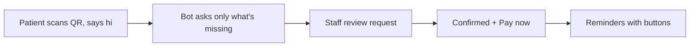
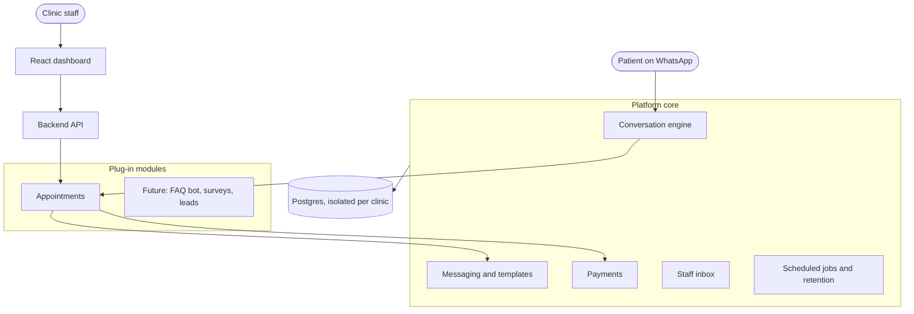
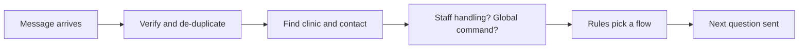
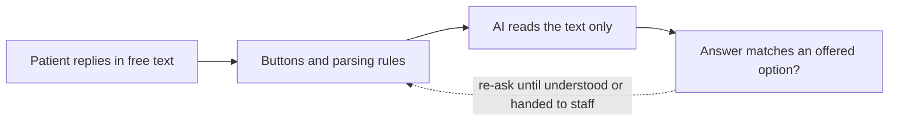

# WhatsApp Business Automation Platform

**Client POC · Conversational Automation · Multi-Tenant Platform**

> A multi-tenant platform that runs a business's WhatsApp number: patients book, reschedule, cancel and pay entirely in chat, staff approve and reply from a live dashboard, and new automation modules plug in without touching the core. The first module is clinic appointment scheduling.

**Engineering areas:** [AI Automation & Integrations](../../engineering-areas/ai-automation.md) · [Full-Stack AI Engineering](../../engineering-areas/full-stack-ai.md) · [Systems, Reliability & Security Engineering](../../engineering-areas/systems-reliability-security.md)

## At a glance

- Book, reschedule, cancel and pay in WhatsApp
- 3 payment options
- 190+ automated tests
- 11 recorded architecture decisions

## Overview

Small businesses already talk to customers on WhatsApp, but by hand. This POC turns a business's WhatsApp number into an automated front desk, with a web dashboard for the team behind it.

It is built as a platform, not a one-off bot. Each business is a separate tenant, and automations are modules that plug into a shared core. The first module is appointment scheduling for clinics: a patient scans the clinic's QR code, chats, and books, reschedules, cancels or pays without a phone call.

## The problem

Clinics we spoke to had the same pain points. Phone booking ties up the front desk and fails after hours. Patients who reschedule are asked for their details all over again, and rescheduling by cancel-and-rebook creates duplicate records and loses history. Doctors can't easily see why a patient is coming in. Collecting fees in advance and reducing no-shows both need manual follow-up.

And every new WhatsApp automation a business wants is usually built from scratch.

## The solution

One platform core, pluggable modules.

The core handles what every WhatsApp automation needs: tenants, contacts, conversations, messaging and templates, payments, a staff inbox, users and roles, audit logging, scheduled jobs and data retention. A module adds its own flows, rules, screens and jobs by registering them, so the core never changes to add one.

The conversation engine routes every incoming message through a fixed pipeline, then picks a flow from the sender's situation: new contact, returning patient, upcoming appointment, payment due, request waiting for the clinic, and so on. Each flow is a list of small steps that ask one question each, and a step skips itself when the answer is already known, so returning patients are never asked twice.

Staff work from a React dashboard: a requests queue to approve, decline or suggest another time; appointments by day with full change history; an inbox to take over a chat, reply and hand it back; payments; privacy requests; and settings for doctors, hours, booking rules, templates and payments. The dashboard updates live when anything changes.

## How it works

A typical booking:

1. The patient scans the clinic's QR code and says hello on WhatsApp.
2. The bot asks for consent, then only for details it doesn't already have: patient, doctor, day, slot and reason.
3. The request lands in the staff queue; staff approve it, decline it or suggest another time.
4. On confirmation the patient gets the booking, a Pay now option (WhatsApp Pay, a Razorpay link or pay at the clinic) and reminders before the visit, by default 24 hours and 2 hours ahead.
5. Each reminder carries Confirm, Reschedule and Cancel buttons that open the right flow from anywhere in the chat.
6. Rescheduling keeps the same appointment and records every change, so the doctor sees the full history.

If a patient types something like "day after tomorrow evening", the bot's own rules try first, and only if they fail (and the clinic has turned it on) does the AI read that one message. Only the text is sent, never names or phone numbers, and the answer is checked against the options the bot actually offered.

## Architecture

Shape: a modular monolith. One backend and one database keep it simple to run, while strict module boundaries mean any module could be split out later.

Inside each module: hexagonal layers (domain, application, infrastructure, presentation) following SOLID. Business rules don't depend on the web framework, the database library or WhatsApp, so they are easy to test and change. Layer rules are checked automatically in CI, so the structure can't quietly erode.

Reliability: state changes and the notifications they trigger are saved together in one transaction and delivered afterwards, so a booking can never be saved without its message, or the reverse. Every handler is safe to run twice. Incoming messages are stored before processing, so nothing is lost if processing fails, and repeat deliveries are recognised.

Tenant isolation: each clinic's data is isolated in the database itself, not just in application code.

Double-booking: concurrent bookings for the same doctor are serialised and overlapping slots are refused, proven by a test where two simultaneous bookings for one slot produce exactly one winner.

Frontend: React and TypeScript, organised by feature with the same layering idea, using API types generated from the backend so the two can't drift apart.

Hosting: serverless on Vercel with managed Postgres, deployed through a CI pipeline that runs linting, type checks, architecture rules and tests first.

## Challenges

Never asking twice. Making every step skip itself when its data is already known is what lets returning patients book in a few taps.

WhatsApp's 24-hour rule. Free-form messages are only allowed for 24 hours after a patient's last message. The platform decides in one place whether to send the message as written or fall back to the clinic's approved template, so modules never have to think about it.

Stale reminders. Rather than cancelling reminder jobs every time an appointment moves, each reminder re-checks that the appointment is still booked at that time before sending.

Serverless background work. With no always-on worker, scheduled jobs, retries and reminders run from a short recurring tick that claims due work and finishes inside the function's time limit.

Privacy by design. Patients can type a deletion request, staff approve it, and a daily retention job removes old closed records on the clinic's chosen schedule, while payment records are kept.

## Results

As a POC, it runs the full appointment journey over WhatsApp: booking, approval, reminders, rescheduling with history, cancellation, payment, staff handover and data deletion, with a live dashboard behind it.

From the codebase: about 190 automated tests across domain rules, use cases, whole WhatsApp conversations, the API and architecture rules, plus 11 recorded architecture decisions. It hasn't run with real clinic traffic yet, so there are no business outcome figures to report.

## What I learned

Build the platform, then the bot. A shared core with plug-in modules turns the second WhatsApp automation into a fraction of the first one's work.

Rules first, AI second. Buttons and simple parsing handle most replies; the LLM only steps in when they fail, and its answers are validated, so the bot stays fast, cheap and predictable.

Make reliability structural. Saving state and its notifications together, and making every handler safe to repeat, removes a whole class of "the patient never got the message" bugs.

Enforce architecture with tools. Automated layer checks keep the codebase consistent long after the first version.

## Future scope

Next on the roadmap: a knowledge-base Q&A (RAG) module so the same WhatsApp number can answer patients' repeated questions about the clinic's services from content the clinic provides, handing over to staff when it isn't sure. After that, more modules on the same core, such as lead capture, feedback surveys and broadcast campaigns, and a pilot with a real clinic to measure no-shows and advance payments.

## Diagrams

### A booking, from QR code to reminder

*The patient books in chat, staff approve from the dashboard, and the confirmed booking brings payment options and reminders with one-tap actions.*

### One core, pluggable modules

*Patients reach the platform through WhatsApp and staff through the dashboard. The shared core handles conversations, messaging, payments and data; feature modules plug in their own flows and screens.*

### How an incoming message finds its flow

*Every message is checked, saved and matched to the right business and contact before rules pick a flow based on the sender's situation.*

### Rules first, AI only when needed

*The bot tries its own rules first. Only if they fail, and the clinic has opted in, the AI reads that one message, and its answer is accepted only if it matches an option the bot offered.*

## Tech stack

`Python` · `FastAPI` · `SQLAlchemy (async)` · `PostgreSQL with row-level security` · `Alembic` · `React` · `TypeScript` · `Vite` · `TanStack Query` · `Tailwind CSS` · `WhatsApp Business Cloud API` · `Razorpay` · `Vercel` · `GitHub Actions`

## Related work

**Experiments**

- [Rules-First vs LLM-First Intent Understanding in a Conversational Booking Flow](../../experiments/README.md#rules-first-vs-llm-first-intent-understanding)

**Automations**

- [Event-Driven Notification & Reminder Pipeline (Transactional Outbox + Scheduled Jobs)](../../automations/README.md#event-driven-notification-reminder-pipeline)

**Prompt patterns**

- Untrusted-Input Boundary Guardrail (Prompt-Injection Defence)
- Schema-Steered Structured Extraction (JSON Without Extra Libraries)

Read the full case study on [Prompt at Work](https://promptatwork.com/ai-lab/work/poc-whatsapp-business-automation-platform).

---

Generated from Sanity by `scripts/sync_from_sanity.py`. Edit the content in Sanity Studio, not in this file.
