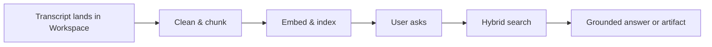
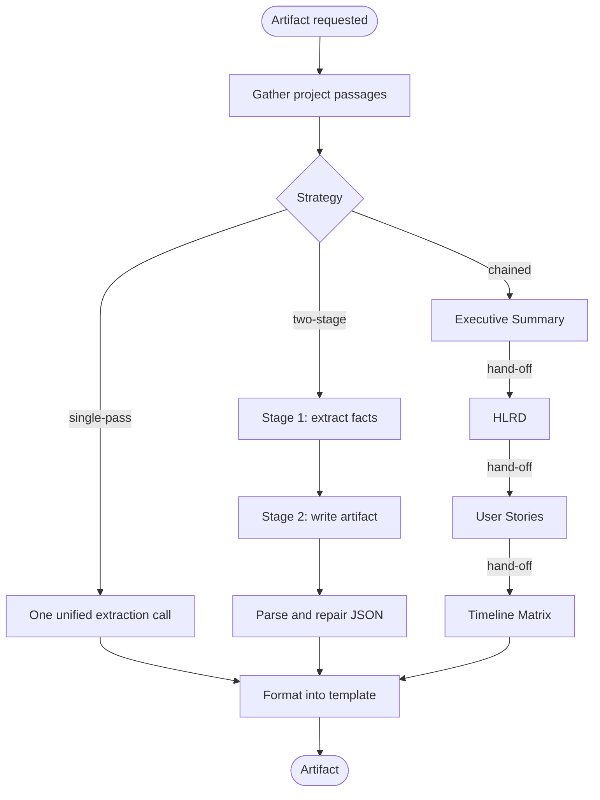
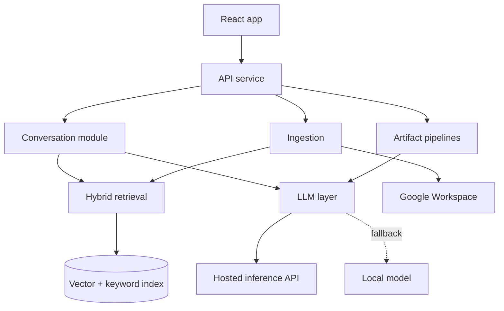
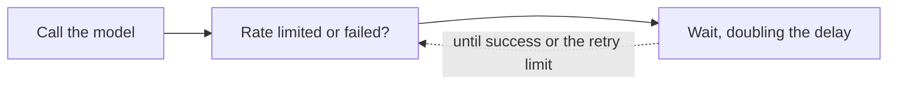
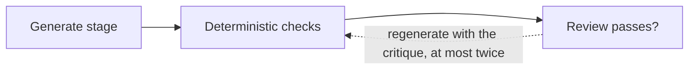

# Automated SDLC Artifact & Technical Specification Generation Pipeline

**Knowledge Retrieval · SDLC Automation · Framework-Free Pipelines**

> A centralized knowledge and synthesis pipeline that ingests a team's meeting transcripts and project documents from Google Workspace, answers questions across them with hybrid retrieval, and generates standard SDLC artifacts (executive summaries, high-level requirements documents, user stories and delivery timelines) in a fixed structure every time, built on deterministic pipelines with no agent framework.

**Engineering areas:** [Full-Stack AI Engineering](../../engineering-areas/full-stack-ai.md) · [RAG & Retrieval](../../engineering-areas/rag-retrieval.md)

## At a glance

- 4 SDLC artifact types generated
- 3 generation strategies (single-pass, two-stage, chained)
- Hybrid semantic + lexical retrieval
- 5 role-based guided flows

## Overview

Delivery teams already record every meeting, but the knowledge stays locked in transcripts. This pipeline turns a team's meetings and project documents into two things: answers to plain-language questions drawn from all of them, and standard SDLC artifacts generated directly from what was said.

It syncs a shared Google Workspace folder through a service account, indexes everything for hybrid search, and generates an Executive Summary, a High-Level Requirements Document (HLRD), User Stories with acceptance criteria, or a Timeline Matrix for any project and time period. Role-based guided flows (Product Owner, Delivery Head, Business Analyst, Scrum Master, General User) lead people who aren't sure which artifact they need.

## The problem

Meetings produce plenty of text, but transcripts pile up and nobody rereads them. A project's history spreads across months of meetings, and the same requirement often comes up several times, changing a little each time, so no single meeting tells the whole story.

When a project needs a requirements document or an executive summary, someone digs through every meeting by hand and writes it from scratch, in a different shape each time. The goal was for a project's meetings to become the source of its documentation directly, in one consistent structure.

## The solution

One idea runs through the system: a prompt library that templates each artifact completely, so every document comes out in the same structure. Four engineering decisions carry most of the weight.

Hybrid retrieval. Every question is searched two ways at once: by meaning, with sentence embeddings in a FAISS index, and by exact words, with a custom BM25 index. The two rankings are merged with Reciprocal Rank Fusion and narrowed by metadata such as project and date.

Model tiers. Small, frequent decisions (intent, slot extraction, query rewriting) use a fast small model; answers use a mid-size model at low temperature to stay grounded; documents use a large model chosen for reliable structured output. A provider layer falls back to a local model when the hosted API fails.

Three generation strategies. Single-pass makes one call that extracts everything the four artifacts need into one JSON, then formats it in code. Two-stage extracts facts first, then writes the document from them. Chained runs Executive Summary, HLRD, User Stories and Timeline Matrix in order, passing a compressed hand-off from each to the next. Single-pass became the default.

Multi-turn context through slots. Each conversation keeps typed slots (project, time range, speaker and others). Per turn, the pipeline extracts intent and slots, merges them with the previous turn, rebuilds a standalone search query, then answers, so a short follow-up like "only last week" still makes sense.

Around the models sit validators: spell-correction with protected domain terms on the way in, and JSON repair and empty-answer checks on the way out.

## How it works

A typical question, such as "What did we decide about X last week?", takes this path.

If the message is a greeting, the pipeline refreshes the index with any new files and replies with the project list and role options. Otherwise an input validator either reformulates the query or asks for clarification.

If a guided flow or clarification is already in progress, it handles the reply. If not, an intent step decides between generating an artifact, asking the user for missing details, or answering directly.

For a direct answer, the conversation layer rebuilds a standalone query from the merged slots, hybrid search returns the most relevant passages for that project and period, the answer model writes from those passages only, and the output is validated before it is shown with copy and PDF options.

## Architecture

Frontend: a React and TypeScript single-page app that renders answers and tables, turns numbered options into clickable chips, and exports answers to PDF in the browser.

Backend: a FastAPI service with conversation, document-generation, ingestion and role-flow modules, and per-request timing for every step.

Ingestion: a Google Workspace connector syncs the shared folder incrementally through a service account; a file processor parses each format; a transcript processor removes filler words and chunks meetings by speaker.

Retrieval: a FAISS vector index and a BM25 keyword index, fused with Reciprocal Rank Fusion and filtered by metadata.

LLM layer: a provider factory with a hosted inference API as primary and a local model as fallback, exponential-backoff retries and task-based model choice.

State: the indexes persist between restarts; conversation sessions and caches are short-lived.

There are no agents in this build: no tool calling and no agent loop. Every step is fixed in code, by design.

## Challenges

Rate limits shaped the architecture. Retries with exponential backoff, pauses between pipeline stages, single-stage fallbacks in the chain, and single-pass as the default all came from the hosted API's limits.

Reasoning text leaking into answers. One model returns its thinking inside tags, which appeared in user-facing text; it is now stripped before any answer is returned.

Malformed JSON. Document parsing runs in layers: parse, repair, extract the JSON block, repair again, then validate.

Context overflow and noisy citations. The number and size of passages are capped before each call, and context is formatted without source numbers so the model stops citing them.

A slow first request. The embedding model loads in the background at startup and the service waits for it before going live.

Misrouted intents. Similar artifact names and project names were being confused, so the slot prompt now carries explicit disambiguation rules and a list of known projects.

## Results

The pipeline is live. It answers questions across meetings with hybrid retrieval, keeps context across turns, generates all four SDLC artifacts in both the single-pass and two-stage strategies, guides users through role-based flows, and exports answers to PDF. The backend has 44 automated test functions covering configuration, error handling, schemas and the API.

The code records timings for every step of every request, but no latency, accuracy, cost or usage figures were saved, so none are reported here. Measuring them is the subject of the linked experiments.

## What I learned

Constraints, not model quality, drove the architecture. Owning every call is what made it possible to design around rate limits precisely.

Template the output completely. Fixed artifact templates are what make generated documents consistent enough to use.

An abstraction only pays off where it is applied. A fallback provider protects only the paths that actually route through it.

Keep prompts and docs in one place. Prompts and configuration drift quickly when copies live in several files.

## Future scope

The pipeline is a deterministic workflow, not an agentic system, and that was the right starting point. The next phase is designed but not built.

Durable conversation state would replace the short-lived session stores so sessions survive restarts and stay strictly per user. The rule-based router would become one structured routing decision with explicit transitions, and clarifying questions would pause and resume cleanly. Q&A would become a tool-using step over the existing hybrid search with a hard cap on calls, and the artifact chain would gain a reviewer after each stage that checks the schema and cross-references (every requirement covered by a story, every story scheduled) and regenerates at most twice.

Whether that orchestration layer uses a graph framework or stays custom will be decided by measurement: tracing and an evaluation set of real questions on today's pipeline come first, so any new design is compared against the current one before it replaces it.

## Diagrams

### From a meeting to a grounded answer

*Transcripts and documents sync from Google Workspace, are cleaned, chunked, embedded and indexed; each question is searched two ways and answered only from the passages it finds.*

### Hybrid retrieval, explained

| Hybrid search with Reciprocal Rank Fusion | A two-person interview panel |
|---|---|
| Vector search ranks by meaning | One interviewer judges overall fit |
| BM25 ranks by exact words | The other checks the CV for required skills |
| RRF scores each result by its rank in both lists | The panel combines positions, not raw marks |
| Passages both searches like rise to the top | Candidates both interviewers rank highly get shortlisted |

*One search ranks passages by meaning, the other by exact words, and RRF combines the two rankings by position, so passages both searches rate highly come out on top. Unlike interviewers, the two searches never discuss a candidate.*

### Three ways to generate an artifact

*Single-pass, the default, makes one extraction call and formats it into any artifact; two-stage extracts then synthesises; chained passes a compressed hand-off from each artifact to the next.*

### Slot state, explained

| Multi-turn slot state | A waiter's order pad |
|---|---|
| Slots: project, time range, speaker | Fields on the order pad: dish, size, table |
| A follow-up keeps every slot | "Tell me more about that dish" |
| A refinement replaces one slot | "Make that a small one" |
| A topic switch clears the slots | A new order on a fresh page |

*The pipeline keeps a small form per conversation. Each message adds to it, changes one field, or starts a new one, and the full search question is rebuilt from the form so short follow-ups still make sense.*

### How the pieces connect

*The web app talks to one API. Inside it, conversation, artifact and ingestion modules share one retrieval layer and one LLM layer with a local fallback; Google Workspace is the only data source.*

### Retrying through rate limits

*A failed model call waits and tries again, doubling the delay each time, until it succeeds or reaches the retry limit; answer calls can then fall back to a local model.*

### Proposed: a reviewer after each artifact stage

*Planned, not built. Each stage's output is checked against its schema and the previous artifact; a failed check regenerates the stage with the critique added.*

## Tech stack

`Python` · `FastAPI` · `Pydantic` · `FAISS` · `Sentence-Transformers` · `BM25 (custom implementation)` · `Google Workspace APIs (service account)` · `Document parsers (PDF, DOCX, XLSX, PPTX)` · `React` · `TypeScript` · `Vite` · `Tailwind CSS` · `pytest` · `GitHub Actions`

## Related work

**Experiments**

- [Single-Pass vs Two-Stage vs Chained Generation of SDLC Artifacts from Unstructured Transcripts](../../experiments/README.md#fast-vs-two-stage-vs-chained-document-generation)
- [Hybrid Lexical + Semantic Retrieval: Chunk Size, Fusion Weight and Latency vs Recall](../../experiments/README.md#hybrid-retrieval-chunk-size-fusion-latency-recall)
- [Framework-Based vs First-Principles Retrieval Pipelines: Same Problem, Two Build Approaches](../../experiments/README.md#framework-vs-first-principles-retrieval-pipelines)

**Automations**

- [Incremental Knowledge Ingestion & Indexing Pipeline](../../automations/README.md#drive-to-meeting-search-index)
- [Transcript-to-SDLC-Artifact Generation Pipeline](../../automations/README.md#meeting-transcripts-to-delivery-documents)

**Prompt patterns**

- Cross-Document Synthesis Answer Prompt (Grounded RAG Q&A)
- Schema-Steered Structured Extraction (JSON Without Extra Libraries)

Read the full case study on [Prompt at Work](https://promptatwork.com/ai-lab/work/sdlc-artifact-generation-pipeline).

---

Generated from Sanity by `scripts/sync_from_sanity.py`. Edit the content in Sanity Studio, not in this file.
